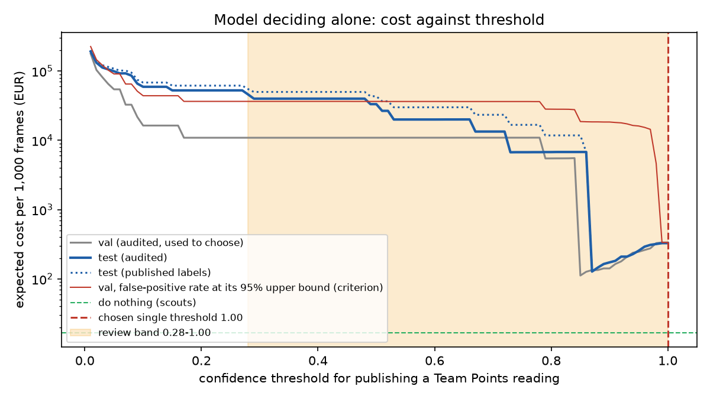

# Assignment 2 Report

> **DRAFT. Every decision below is a proposal to rewrite in your own words.**
> The brief requires the framing, costs, thresholds and conclusions to be
> yours. Every figure comes from `artifacts/metrics.json`, which
> `main.py train` writes. Delete this box when the text is yours.

- **Name**: Paul Coyral
- **Student ID**:
- **Email**: pcoyral.ieu2022@student.ie.edu
- **Group**: [BBADBA 5A | BBADBA 5B | PPLEDBA 5A | BDBA 3A]

## Business problem, and the cost of being wrong

**The decision.** A sports-data company sells a live basketball score feed to
bookmakers, who price in-play markets off it. Today one human scout per game
watches the broadcast and keys in every score change. The model reads the
broadcast scoreboard instead. In a frame sampled every 2 seconds, it finds the
**Team Points** boxes, and each box is cropped, OCR'd and published as that
team's score. For every reading the system decides whether to **publish it
automatically, send it to an operator, or drop it**. The operator is one
person watching a queue for many games at once.

**Who acts on it.** The bookmakers' trading engines act on a published score
within seconds, with no human in between. That is why a wrong score is
expensive and a late one is not.

**Mistakes in each direction** (per Team Points reading; EUR figures in
`settings.py`):

| Outcome | What happens | Cost |
|---|---|---|
| **False positive**: something that is not this game's score is published as the score | Markets re-price on a wrong number. Bets struck on it are voided under palpable-error rules, the client claims an SLA credit, and trust in the feed drops. | **EUR 150** |
| **False negative**: a real score box is not read | Nothing wrong goes out; the feed keeps the last score. This only costs anything if the score had just changed (about 1 frame in 100). Then the update has to be keyed in by hand, late. | **EUR 0.21** = 1.03% x EUR 20 |
| **Sent to an operator** | The operator looks at the cropped scoreboard and confirms or rejects it. | **EUR 0.05** per frame |
| True positive | The correct score goes out. | EUR 0 |

The asymmetry is roughly **730 : 1** per reading. A false positive reaches
money directly. A false negative falls back to a human, and most of the time
it costs nothing because the score did not change in that 2-second window.
Everything downstream follows from this: the threshold for publishing without
a person, and whether to publish without a person at all.

*Where the figures come from (proposals; replace with your own reasoning):*
- **EUR 150 per wrong score.** A wrong score lives roughly 10–20 s before a
  human catches it. In-play turnover on one game is of the order of a few
  hundred euros a minute per client, voided bets carry handling costs, and
  data contracts carry per-incident credits. EUR 150 is an order of magnitude,
  not a quote, and the sensitivity table varies it from EUR 1.50 to EUR 1,500.
- **EUR 0.21 per missed reading.** A team scores about 40 times a game (about
  100 points), and a broadcast is 130 minutes, or 3,900 frames at one every
  2 s. So the chance that a given reading is a fresh change is 40 / 3,900 =
  1.03%. When it is, the change has to be typed in by hand about 10 s late.
  That keeps markets suspended longer, priced at EUR 20.
- **EUR 0.05 per frame reviewed.** 3 s of operator time at EUR 30/h is
  EUR 0.025, doubled for the 3 s the review delays publication.
- **Doing nothing** costs one scout per game for the whole broadcast:
  2 s x EUR 30/h = **EUR 16.67 per 1,000 frames**. That is the bar any design
  has to clear.

One design choice matters as much as the costs. **The pipeline only asks the
operator about a reading that would change the published score.** A correct
reading of an unchanged score needs no one, so it reaches a person only about
1% of the time. A wrong reading (a shot clock, a promo graphic) almost always
differs from the published score, so it always reaches them.

## Dataset

- **Workspace / project / version**: `roboflow-universe-projects` /
  `basketball-players-fy4c2` / **v21** (`raw-images-scoreboardClassesOnly-withNullImages`)
- **Link**: https://universe.roboflow.com/roboflow-universe-projects/basketball-players-fy4c2/dataset/21
- **License**: CC BY 4.0. Used as published, not forked.
- **One image** is one broadcast frame (1920x1080 or 1280x720). Most are NBA
  and NCAA TV broadcasts (ESPN, team regional networks, TNT); some are a fan's
  video of Iowa vs Nebraska shot from the stands.
- **Classes (5)**: Period, Shot Clock, Team Name, **Team Points** (the
  positive class), Time Remaining.

**Why it serves the problem.** The labels are exactly the scoreboard fields a
score feed has to read, drawn on real broadcast graphics in several designs.
The dataset also keeps **frames with no scoreboard** (close-ups, crowd shots,
the arena camera), which is where false positives come from in production.
Several ESPN frames carry a bottom ticker or a promo with *other* games'
numbers ("25 Ohio State vs 17 Duke"). That is the most realistic
false-positive trap there is: a real number, in a score-like box, that is not
this game's score.

**Why v21 and not the latest v25.** v25 has the same validation and test
frames, but its training set is the same 114 frames augmented 10x offline,
including horizontal flips. A mirrored scoreboard is not a scoreboard, so I
used the raw frames and let Ultralytics augment online with flipping off
(`fliplr=0`).

## What the dataset's composition implies

| Split | Frames | Labelled as no scoreboard | Of those, actually showing one |
|---|---|---|---|
| Train | 114 | 36 | 2 |
| Val | 32 | 10 | 2 |
| Test | 24 | 6 | 1 |

| Class | Train | Val | Test | Median box area (% of frame) |
|---|---|---|---|---|
| Period | 79 | 23 | 18 | 0.07% |
| Shot Clock | 71 | 19 | 17 | 0.05% |
| Team Name | 68 | 20 | 12 | 0.15% |
| **Team Points** | 154 | 45 | **36** | 0.12% |
| Time Remaining | 77 | 22 | 17 | 0.13% |

What follows from this:
- **Every test number rests on 12–36 boxes.** One Team Points box is about
  3 points of recall, and one Team Name box (6 test frames) is about 8.
  Per-class differences smaller than that are noise.
- **The cost sweep rests on 18 positive and 6 negative test frames.** "Zero
  wrong scores published" on 30 readings does not mean a zero rate: the 95%
  upper bound is still about 11%. At EUR 150 per error, that bound, not the
  point estimate, decides whether to publish without a person (see below).
- **The labels contain errors that matter for exactly this decision.**
  Looking at every frame labelled "no scoreboard", I found 5 that plainly show
  this game's scoreboard (70–81, 42–50, 108–108, 106–106, 108–108).
  - On those frames the model's correct readings count as false positives.
    They were the four most confident "errors" on validation (0.88–0.98).
    Left in, they push the auto-publish threshold to 0.98.
  - I did not relabel anything. I list the frames in `settings.py`, report
    costs on both the published labels and an *audited* view that leaves
    them out, and choose thresholds on the audited view.
  - In train, the same error taught the model that two real scoreboards are
    background.
- **The objects are tiny.** A Team Points box is a median 0.12% of the frame,
  about 50x50 px at 1080p. At the default 640 px input it would shrink to
  about 17 px, so I trained at 960 px.
- **The test split only partly resembles production.** Its frames come from
  the same networks and season as train, so it measures "a scoreboard design
  we have seen". A new league or a redesigned graphic is out of distribution,
  and these numbers would not transfer. Test has 25% no-scoreboard frames
  against the 20% I assume in production, so the reweighting is mild.

## Finetuning and baselines

**Model and task.** Object detection, `yolo11n` finetuned from its COCO
checkpoint. Detection rather than classification because the feed needs to
know *where* each score is so it can crop it for OCR, and a frame has two.

**Where and how it was trained.** Apple M1 (8 GB) on MPS, PyTorch 2.11, in
36 minutes. Settings: 960 px, batch 4, up to 100 epochs, patience 30 (it
stopped at epoch 75; the best was epoch 45), `fliplr=0`, seed 0. I tried
`yolo11s` first, but at 960 px it needed about 5.4 GB and swapped the 8 GB
machine to 20 s per batch. `yolo11n` uses 3.5 GB and has fewer parameters to
overfit 114 frames with.

**Results on the same 24 test frames:**

| Model | mAP50 | mAP50-95 | Team Points AP50 |
|---|---|---|---|
| **Finetuned yolo11n** | **0.931** | **0.606** | **0.960** |
| COCO yolo11n, zero-shot | 0.000 | 0.000 | 0.000 |
| Predict nothing | 0.000 | 0.000 | 0.000 |

The zero-shot model is zero by construction: COCO has no scoreboard class.
On the test frames it found 398 `person`, 11 `chair`, 2 `umbrella` and one
`surfboard`, `tennis racket` and `sports ball`, and nothing on the
scoreboard. So for this decision the two baselines are the same policy:
never read a score. Costed, that is EUR 328 per 1,000 frames (every real
score missed). The gap to the finetuned model is as large as expected,
because the baselines cannot do the task at all. The interesting comparison
is against the scouts, below.

## Per-class evaluation and failure modes

**Positive class:** Team Points. It carries the headline number, and it is
the only field that gets published as a score.

| Class | Test boxes | AP50 | mAP50-95 | Precision @ 0.28 | Recall @ 0.28 |
|---|---|---|---|---|---|
| Period | 18 | 0.966 | 0.654 | 0.94 | 0.89 |
| **Shot Clock** | 17 | **0.820** | 0.530 | 0.86 | **0.71** |
| Team Name | 12 | 0.950 | 0.587 | 0.71 | 1.00 |
| **Team Points** | 36 | **0.960** | **0.697** | **0.80** | **1.00** |
| Time Remaining | 17 | 0.956 | 0.564 | 0.88 | 0.82 |

Confusion matrix at the lower threshold, 0.28 (rows actual, columns
predicted):

| actual \ predicted | Period | Shot Clock | Team Name | Team Points | Time Rem. | background |
|---|---|---|---|---|---|---|
| Period | 16 | | | **1** | | 1 |
| Shot Clock | | 12 | | | 1 | 4 |
| Team Name | | | 12 | | | |
| Team Points | | | | 36 | | |
| Time Remaining | | | 1 | **1** | 14 | 1 |
| background | 1 | 2 | 4 | **7** | 1 | |

- **Team Points is reliable at finding the score.** All 36 test boxes are
  found above 0.28; the weakest real one scored 0.60.
- **Its failure is precision, and it is the expensive kind.** 9 readings
  above 0.28 are not this game's score:
  - a *Period* box read as a score and a *game clock* read as a score;
  - 7 on background, which include the **"25 Ohio State vs 17 Duke" promo**
    graphic at 0.86 and team logos inside the scoreboard bug.
  - On validation the worst genuine errors were a game clock at 0.85 and a
    logo at 0.78. So the model's confident mistakes go as high as its
    ordinary correct readings (0.60–0.98). **Confidence alone does not
    separate them.**
- **Shot Clock is the class dragging the average.** It has the lowest AP50
  (0.82) and recall (0.71), and the smallest boxes (0.05% of the frame). 4 of
  its 5 misses are not detected at all. It is not published in this design,
  but a feed that also sold shot-clock data could not use it yet.

## Cost matrix and operating point

**How the thresholds were chosen.** I swept both thresholds over 0.01–1.00
in steps of 0.01 on the **audited validation split** and priced every pair on
the **audited test split**. Choosing and scoring on the same 24 frames would
flatter the result.
- An upper threshold of 1.00 means never publish without a person.
- The criterion is expected cost per 1,000 frames, with the false-positive
  rate among auto-published readings set at its **95% upper bound** (Wilson)
  rather than its observed value.
- Flat stretches of the curve are resolved by taking their middle.

**Base rate:** 80% of sampled frames show this game's scoreboard. The rest
are replays, close-ups, crowd shots and ad breaks. The test split has 75%.

**The result: lower threshold 0.28, upper threshold 1.00.** The model does
not publish anything on its own yet. Everything at or above 0.28 goes to an
operator whenever it would change the published score.

Why not publish the confident readings automatically?
- Swept on the point estimate, the same procedure picks 0.85. Validation has
  no error above it, and it looks cheaper on validation (EUR 3.9 vs EUR 4.4
  per 1,000 frames).
- On test it publishes the Ohio State/Duke promo at 0.86. That one wrong score
  costs **EUR 6,678 per 1,000 frames**, against EUR 11.5 for never publishing
  automatically.
- What auto-publishing saves is small. A correct reading only needs a person
  when the score changed, so publishing it automatically saves
  1.03% x EUR 0.05 = EUR 0.0005.
- What it risks is large. With about 30 error-free readings on validation, the
  upper bound on the error rate is still about 11%, which is about EUR 17 of
  expected loss per reading.
- The sweep with the upper bound sees both. The point-estimate sweep sees only
  the saving.

**The assumption that would most change the answer is the review cost.**
- At EUR 0.05 per frame, review wins narrowly: EUR 11.5 against EUR 16.7 for
  the scouts.
- Break-even is **EUR 0.072 per frame reviewed**, about 4.3 s of operator
  time. If reviews take longer than that, keeping the scouts is cheaper.
- At 10x the review cost (EUR 0.50) the review design costs EUR 115, and at
  100x the sweep pushes the lower threshold up to 0.85.
- Varying the false-positive cost from EUR 1.50 to EUR 1,500 never makes
  auto-publishing worth it on this evidence. Only at EUR 1.50 does the
  model-alone threshold drop to 0.85.

Sensitivity (thresholds re-chosen on validation each time, priced on audited
test):

| Changed assumption | t_low | t_high | EUR / 1,000 frames | Share to a person |
|---|---|---|---|---|
| none (the design) | 0.28 | 1.00 | 11.52 | 23.0% |
| FP = EUR 1.50 / 15 / 1,500 | 0.28 | 1.00 | 11.52 | 23.0% |
| missed update EUR 5 / EUR 80 | 0.28 | 1.00 | 11.52 | 23.0% |
| base rate 60% / 95% | 0.28 | 1.00 | 11.14 / 11.81 | 22.3% / 23.6% |
| review cost x0.5 | 0.28 | 1.00 | 5.76 | 23.0% |
| review cost x10 | 0.28 | 1.00 | 115.24 | 23.0% |
| review cost x100 | 0.85 | 1.00 | 395.25 | 5.4% |

## What a person still has to check

**Thresholds:** below 0.28, drop. From 0.28 up, send to an operator *if it
would change the published score*. Publish automatically: nothing yet. The
three outcomes are "fail" (drop), "review" and "pass" (publish). "Pass" is
switched off until the evidence below exists.

**Load.** **23.0% of frames** reach an operator (25.7% on the published
labels).
- Almost all of it is wrong readings in the band: junk on null frames, logos
  and promos. Each one recurs every 2 s while it stays on screen.
- At 40 games a day and 3,900 frames a game (156,000 frames), that is
  **about 36,000 reviews a day at 3 s each, or 30 operator-hours**.
- Games cluster in evening windows. With 12 live at once, that is about **83
  reviews a minute, or 4.2 operators busy at the peak**. Today it takes 12
  scouts and 87 scout-hours.
- **Is it realistic?** Yes, for a team of about 6 operators per evening shift
  with headroom. A 3-second confirm on a cropped image is a realistic task,
  and 83 a minute across 6 people is one every 4–5 seconds each, which is
  tight but feasible.

**Against the alternatives** (audited test, EUR per 1,000 frames, base rate
80%):

| Policy | EUR / 1,000 frames | Wrong scores published | Frames to a person |
|---|---|---|---|
| Do nothing (a scout per game) | 16.67 | 0 | n/a (12 scouts at peak) |
| A person checks every frame | 50.00 | 0 | 100% |
| Model alone (best threshold, upper-bound criterion: never publishes) | 328.21 | 0 | 0% |
| Model alone at 0.85 (point-estimate sweep) | 6,794 | 1 | 0% |
| **Model + review band, 0.28 / 1.00** | **11.52** (95% CI 4.8–20.2) | **0** | **23.0%** |

The review design is the only option that beats doing nothing, and only by
about 30%. Its bootstrap interval (resampling test frames) reaches EUR 20.2,
above the scouts' EUR 16.7. **On 24 test frames I cannot claim it is cheaper
than today. I can claim it is not a disaster, which the model alone is.**

**What I would ship:** a shadow-mode pilot. The review band runs alongside
the scouts for a few weeks, which measures the two numbers this decision
hangs on:
- how long a review really takes (break-even is 4.3 s);
- the false-positive rate above a candidate auto-publish threshold.

To make auto-publishing worth it at the current review cost, the upper bound
on that rate would have to fall below 3.4 per million. That takes about a
million error-free readings, which is not realistic. If a 3-second delay on a
score change is really worth EUR 5 to clients, the bar drops to about 11,000
error-free readings. Counted as independent scoreboard states rather than
near-identical consecutive frames, that is a few weeks of pilot data.

## Limitations & next steps

- **Thresholds chosen on 32 frames, checked on 24.** The single error that
  sank the 0.85 threshold is one frame. *Next:* label a few hundred frames
  from new broadcasts (other networks, other leagues) and re-run the sweep
  per scoreboard design.
- **Label errors in the published dataset** (5 of 52 "no scoreboard" frames
  show one). *Next:* fix them in a proper labelled version and retrain, since
  training on them taught the model that two real scoreboards are background.
  Until then, results are reported both ways.
- **Same-broadcast test split.** *Next:* hold out whole broadcasts (one
  network, one arena) so the test measures a scoreboard design the model has
  never seen.
- **Review load is mostly junk recurring every 2 s.** *Next:* when an
  operator rejects a box, suppress that box location for the rest of the
  segment. That would cut most of the 23% while still catching new errors.
- **Frames are not independent.** Consecutive frames repeat the same
  scoreboard, so the bootstrap and the "readings needed" figures overstate
  the evidence. *Next:* count evidence in scoreboard states or games, not
  frames.
- **OCR is assumed perfect.** A correct box with a misread digit is also a
  wrong score. *Next:* add the OCR step to the pipeline and cost its errors
  the same way.
- **Shot Clock recall is 0.71.** Fine for this decision, but not for a feed
  that sells shot-clock data. *Next:* more training examples, or a larger
  input size for that crop.

## Generative AI use disclosure

I used Claude Code (Anthropic) for this assignment. It wrote the code
(`train.py`, `costing.py`, `settings.py`, `app.py`) and produced a first draft
of this report from the pipeline's outputs. I chose the dataset and the
scoreboard framing from options it presented, then reviewed, rewrote and
decided [**edit to describe what you actually changed, and which cost
figures, thresholds and the label audit you checked or changed yourself**].
